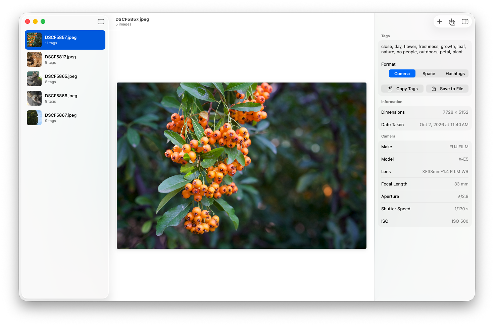

# Image Tagger for macOS

Image Tagger predicts an image's keywords using a deep learning model based on ResNet. It helps photographers
automate the image tagging process. 📸

This is a native macOS port of the Java/Kotlin [ImageTagger](https://github.com/dnutiu/ImageTagger), written in
SwiftUI, with the tagging model running on Core ML.

<picture>
  <source media="(prefers-color-scheme: dark)" srcset="docs/screenshot-dark.png">
  
</picture>

## Features

- Add photos with **File › Add Images…** (⌘O), by dragging images or folders onto the window or the Dock icon, or
  with **Open With › ImageTagger** in Finder. Folders are searched recursively.
- Images are analyzed in parallel in the background. Progress is shown at the bottom of the sidebar, and
  **Image › Stop Analyzing** (⌘.) cancels the remaining images.
- The inspector shows the predicted tags and the photo's metadata: dimensions, date taken, author, camera, lens,
  focal length, aperture, shutter speed and ISO.
- Tags can be formatted with commas, spaces or as hashtags, and copied with **Edit › Copy Tags** (⇧⌘C), ⌘C in the
  sidebar, or the Copy Tags button.
- Tags can be saved into the image files with **File › Save Tags to File** (⌘S) or
  **File › Save Tags to All Images…** (⌥⌘S). To save them as soon as each image is analyzed, turn on
  **Settings › Save tags to image files automatically**. See [Saving tags](#saving-tags).
- Double-click an image, or press Return in the sidebar, to open it in the default viewer. The context menu can
  also show it in Finder or remove it from the list.

## Saving tags

Tags are added to the keywords stored in the file, the field Lightroom, Capture One, Photo Mechanic, Bridge, Spotlight
and Windows show as keywords or tags. Existing keywords are kept, and tags that are already there aren't added again.

- Keywords are written to XMP `dc:subject`. If the file also has legacy IPTC IIM keywords, they're updated too.
- The image data is copied as is, without being compressed again, so there's no quality loss.
- JPEG, HEIC and TIFF images get the keywords in the file. PNG images are left unchanged.
- RAW images (CR2, CR3, NEF, ARW, RAF, ORF, RW2, DNG and others) aren't changed. Their keywords are saved to an XMP
  sidecar file with the same name, for example `IMG_1234.xmp` for `IMG_1234.CR2`, which Lightroom, Bridge, Capture One
  and Photo Mechanic read. An existing sidecar keeps its other metadata, including the develop settings of photo
  editors, and a sidecar that can't be read is never replaced. Lightroom reads the metadata of DNG files from the DNG
  itself, so it doesn't see sidecars of DNG files.
- The new file is checked before it replaces the original. When the folder can be written, the file is replaced
  atomically. Otherwise, when only the file was opened, it's rewritten in place.
- The sandbox only gives access to the files the user opens. Sidecars are accessed with a file presenter, because
  `ImageTagger-Info.plist` declares the `xmp` extension as a related item type (`NSIsRelatedItemType`).

## Requirements

- macOS 26.5 or later
- Xcode 26.6 or later

## Building

The Core ML model's weights (116 MB) are stored with [Git LFS](https://git-lfs.com), because GitHub doesn't allow
files over 100 MB in a repository. Install Git LFS before cloning, so the model is downloaded with the code:

```shell
brew install git-lfs
git lfs install
git clone https://github.com/dnutiu/ImageTaggerMac.git
```

If you cloned without Git LFS, run `git lfs pull` in the repository to download the model.

Open `ImageTagger.xcodeproj` and run the **ImageTagger** scheme, or build from the command line:

```shell
xcodebuild -project ImageTagger.xcodeproj -scheme ImageTagger build
xcodebuild -project ImageTagger.xcodeproj -scheme ImageTagger test
```

### Regenerating the model

`ImageTagger/Resources/TagPrediction.mlpackage` is converted from the ONNX model of the Java version:

1. Download the AIModels archive from the
   [ImageTagger releases page](https://github.com/dnutiu/ImageTagger/releases). It contains `prediction.onnx` and
   `prediction_categories.txt`.
2. Convert the model:

   ```shell
   python3 -m venv .venv
   .venv/bin/pip install -r Scripts/requirements.txt
   .venv/bin/python Scripts/convert_model.py \
       --onnx path/to/prediction.onnx \
       --labels path/to/prediction_categories.txt \
       --output ImageTagger/Resources/TagPrediction.mlpackage
   ```

The conversion wraps the network with ImageNet normalization and a sigmoid output, embeds the 1708 tag names, and
stores the weights as 16-bit floats. Its predictions match the original 32-bit ONNX model. 8-bit weights would halve
the size, but they changed the predicted tags.

## Project structure

| Path | Purpose |
| --- | --- |
| `ImageTagger/Model` | Tag prediction with Vision and Core ML, image loading and metadata reading with ImageIO, tag formats. |
| `ImageTagger/Session` | The observable session: the list of images, the analysis queue, cancellation and actions. |
| `ImageTagger/Views` | The SwiftUI sidebar, image preview and inspector. |
| `ImageTagger/ImageTaggerCommands.swift` | The menu bar commands. |
| `ImageTagger-Info.plist` | Declares the image and folder types the app can open, and XMP sidecars as related items. It's merged with the generated Info.plist. |
| `Scripts` | Converts the ONNX model to Core ML. |

## Differences from the Java version

- Images are fed to the model in RGB. The Java version read the red channel for all three color channels, so
  predictions differ. For the night photo in the tests, they now include "night" instead of "tranquil".
- Hashtags join multi-word tags, for example `#nopeople` instead of `#no people`.
- The selected tag format is remembered between launches.
- Image orientation is applied before analysis, so rotated photos are tagged upright.

## Credits

- Icon: [Image analysis icons created by Dewi Sari - Flaticon](https://www.flaticon.com/free-icons/image-analysis)
- Test photos: [https://unsplash.com/@ndcphoto](https://unsplash.com/@ndcphoto)
- Blog: [https://blog.nuculabs.dev](https://blog.nuculabs.dev)

Licensed under the GNU General Public License v3.
